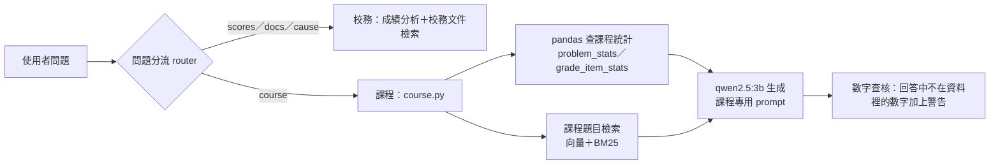

# 加入 Python 課程資料：做法與發現

> 資料集本身與去識別化規則見 [data/course/python/README.md](../data/course/python/README.md)。這份文件記錄怎麼把它接進系統，以及過程中發現的問題。

## 接進系統的方式

助教提供的校務資料（`scores.csv`、`data/principal/docs/`）與成績分析程式完全不動，課程資料是**另一條獨立的路**，期末換 `scores.csv` 不受影響。

| 環節 | 做法 |
| --- | --- |
| 分流 | 規則新增 `course` 類：問題提到 Python、程式、題目、隨堂考、提交、迴圈、函式、字典等詞就走這一類。加入後，原本 78 題分流評測集沒有任何一題被誤分到 `course` |
| 統計查詢 | `api/app/course.py` 依問題選一種固定查詢：最難的題目（提交中通過比例最低）、執行錯誤或超時最多的題目、隨堂考或各成績項目、各單元作答人數。每項結論附 `evidence`，查詢可用 `ps = pd.read_csv(...problem_stats.csv)` 重跑 |
| 題目檢索 | 43 題一題一塊；向量（bge-m3）與 BM25（字元二元組）以 RRF 合併 |
| 內容題 | 「有沒有考切片的題目？」這類問題目內容的，只檢索題目、不附統計 |
| 生成 | 課程專用的 system prompt；明確說明「提交中通過的比例低＝要試很多次」 |
| 數字查核 | 生成後找出回答中、資料事實與引用題目都沒有出現的數字，附上警告 |

## 過程中發現的問題（按發現順序）

每個問題都是實際送問題、逐句讀回答時發現的。

| # | 現象 | 原因 | 修正 |
| --- | --- | --- | --- |
| 1 | 「哪一題最多人卡關？」事實寫「Accepted 比例最低」，模型解讀成「提交次數最少」，意思完全相反 | 事實只列題名、沒有數字，模型自己猜指標的意思 | 事實附上數字（「提交中通過的比例 6%」），prompt 說明這個指標的意思 |
| 2 | 「隨堂考成績怎麼樣？」模型回答「資料中沒有 Python 課的成績資料」 | 沿用校務的 system prompt，裡面寫「成績資料只有學期、年級、班級……」 | 課程路徑改用課程專用 prompt |
| 3 | 「有沒有考字串切片的題目？」沒檢索到 PY-C2-A2（題目明寫「使用切片(Slice)」） | 只用向量檢索；這一題排第 4 | 改成向量＋BM25（見下一節） |
| 4 | 問題目內容，卻附上「最難的三題」統計 | 沒有對應的查詢時，退回預設的統計查詢 | 偵測「有沒有…題」「哪一題在考／練習…」等問法，只檢索題目 |
| 5 | 「哪一題最多人卡關？」事實寫 PY-C6-P1，回答卻說 PY-C2-P1 | sources 來自檢索，「最多人卡關」檢索到 3 題不相關的題目，模型被帶偏 | 統計題的 sources 直接用統計結果點名的題目 |
| 6 | 「哪一題在練習 while 迴圈？」沒有走課程路徑 | 分流規則沒有「迴圈」「while」等程式用語 | 補上程式用語，並確認 78 題評測集沒有被誤分 |
| 7 | 隨堂考題目附上 3 題無關的練習題 | 成績項目和個別題目無關，卻仍做題目檢索 | 成績項目查詢不做題目檢索 |
| 8 | **模型編造數字**：事實只給「C1 平均 74 分」，模型寫出「C2 76 分、C3 77 分、C4 78 分」和根本不存在的「C5 隨堂考」 | prompt 雖然寫了「只能用資料中的數字」，但只給模型一個最低值，其他項目它就自己補 | ①事實完整列出所有項目（含「平均不公開」）；②新增數字查核，回答中出現資料沒有的數字就附警告 |

## 學到的事

1. **同一種檢索方法，換一份資料結論就可能相反**。校務文件的難題集上，向量＋BM25（版本 B）比純向量差；課程題目上卻是混合比較好。我們用 4 題實測：混合在每一題都不比純向量差，「切片」從第 4 名升到第 3 名。原因是課程題目和問法都充滿「切片」「while」「字典」「函式」這類**相同的技術詞**，字面比對正好有用；校務的難題則多半是換句話說。（只有 4 題，是單一觀察，不是結論。）
2. **模型會把沒給它的東西補齊**。問題 8 最危險：數字看起來很合理，卻是編的。「在 prompt 裡叫它不要編」不夠，要做到兩件事：把它需要的數字全部給它，並且用程式檢查回答裡的數字。
3. **事實和引用要一致**。問題 5 裡，程式算出的事實是對的，但送給模型的參考題目是檢索來的、和事實無關，模型就跟著參考題目走。
4. **3B 模型的閱讀理解有限**。「有沒有考字串切片的題目？」即使已經檢索到 PY-C2-A2，模型仍然回答「並未涉及字串切片」。推論也常前後矛盾，例如「中位數 100 分，可能是因為題目較難」。這些都標成推測，但仍會誤導人，所以介面上一定要同時顯示「資料顯示的事實」與 Sources，讓使用者自己核對。

## 測試結果

- 6 題課程問題：每題的 `evidence` 都用 pandas 獨立重跑，結果與回傳一致。
- 加入課程路徑後，校務公開題 `tests/principal.jsonl` 仍是 12/12、`my_tests.jsonl` 2/2、evidence 20/20，沒有退步。

## 範例問題（demo 用）

| 問題 | 會看到 |
| --- | --- |
| Python 課哪一題最多人卡關？ | PY-C6-P1「數到指定數字」（提交中通過的比例 6%）等三題，Sources 是這三題的題目 |
| 哪些題目最容易出現 Runtime Error？ | 執行錯誤比例最高的三題 |
| Python 課的隨堂考成績怎麼樣？ | C1～C4 的平均與中位數；人數太少的平均顯示「不公開」 |
| Python 課後面單元的作答人數有變少嗎？ | 作答人數到 C6 明顯變少（C5 約 30 人、C6 約 15 人，人數已四捨五入） |
| 哪一題在練習 while 迴圈？ | 檢索到 C6 的 while 題 |
