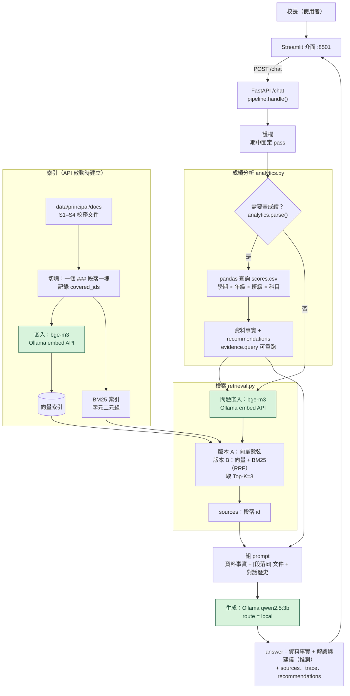

# 期中報告

> 繳交前請刪除所有 `>` 開頭的說明文字。

- 組別角色：校長 AI 決策助手
- 組員：黃俞絜，115522100，yujieeeeeee（姓名、學號、GitHub 帳號）
- 繳交 commit：（`git rev-parse midterm` 的結果）

## 1. 系統架構



綠色節點走 Ollama 地端模型：檢索的嵌入（`bge-m3`）與生成（`qwen2.5:3b`）。本組不使用雲端 API，所有回覆都由地端模型產生，`route` 固定回 `local`。

| 階段 | 位置 | 說明 |
| --- | --- | --- |
| 切塊、索引 | `api/app/retrieval.py`（`chunk_documents`、`get_index`） | API 啟動時（`main.py` 的 `warmup`）建立；一個 `###` 段落一塊 |
| 檢索 | `retrieval.retrieve(query, k, version)` | 版本由 `RETRIEVER_VERSION` 切換，回傳段落 id 作為 `sources` |
| 成績分析 | `api/app/analytics.py`（`analyze`、`run_query`） | pandas 計算兩學期差值並逐層找出下滑最多的年級、科目、班級；每項結論附可重跑的 `evidence.query` |
| 生成 | `api/app/pipeline.py`（`generate`，呼叫 Ollama `/api/chat`） | 數字由 pandas 算好放進 answer 的「資料顯示的事實」，模型只寫「解讀與建議」，事實與推測分開 |

## 2. 設計決定與理由

| 項目 | 選擇 | 理由 |
| --- | --- | --- |
| 切塊方式 | 一個 `###` 段落一塊（共 25 塊），每塊記錄 `covered_ids` | 文件本身已用 `###` 切成語意完整、自帶 id 的段落，一塊對應一個 id，`sources` 不需另外計算歸屬。也試過整個 `##` 章節一塊與滑動視窗：章節切塊 Recall@3 從 1.00 掉到 0.78（S1-3 同時含新實驗室與晨讀，晨讀題 eval-16 掉到第 8 名）；滑動視窗會切斷段落，必須另外判斷一塊算哪一段，Recall@3 也只有 0.88。詳見 [方法比較實驗](retrieval-experiments.md#切塊方式)。 |
| 切塊大小（註明單位：字元或 token） | 依段落自然長度，不設上限：平均 83 字元，最短 32、最長 157 字元 | 最長的段落也遠低於 bge-m3 的 8192 token 輸入上限，再切小只會把一件事拆成兩半（例如 S1-2-1 的「育嬰留停」與「代理教師接任」）。滑動視窗實驗用 120 字元、重疊 40 字元（約一個半段落），沒有比段落切塊好。 |
| 嵌入模型 | `bge-m3`（1024 維，多語）；Docker 內透過主機 Ollama 的 `/api/embed` 地端執行 | 三個模型在同一條件下比較：bge-m3 的 Recall@3 為 1.00、MRR 0.90；bge-small-zh-v1.5（512 維）速度快約 10 倍，但「額外講義」對「補充教材」這題（eval-12）掉到第 4 名；多語 MiniLM（384 維，以英文為主訓練）各項最差（MRR 0.82）。選 bge-m3 的另一個原因是部署：Ollama 官方有 bge-m3，驗收機可地端執行、Docker 映像不用裝 torch；bge-small-zh 沒有官方 Ollama 版本。 |
| K 值 | 3（每次取 3 個切塊；段落切塊下即 3 個段落），`RETRIEVER_K` 可調 | K=1 時 A 只有 13/16、B 15/16，因為向量的第 1、2 名常常只差 0.01–0.02，排序不穩；K=3 兩版都 16/16，也剛好放得下跨兩段的題目（eval-08、09、10、14）。K=5 沒有多命中任何一題，多出的 2 段都無關，只會讓 3B 地端模型讀更長、更雜的 context。 |
| 檢索方法 | A：向量餘弦相似度；B：向量＋BM25（字元二元組）以 RRF 合併 | 向量擅長換句話說（「請長假、找人代課」對「育嬰留停、代理教師」，A 排第 1；BM25 排第 5）；BM25 擅長原文詞、班級代號與時間（805、16:10），兩者互補，B 的 MRR 從 0.90 提高到 0.97。中文 BM25 用字元二元組而不用 jieba：jieba 沒有比較好（Hit@3 一樣是 15/16），還多一個套件。不用重排序：bge-reranker-base 的 Hit@1 從 15 掉到 13、每題延遲約 5 倍，Docker 還得裝 torch。不用加權合併：需要正規化分數並調 α，MRR 0.94 也比 RRF 差。**限制**：在難題集（概括、口語問法）上 B 反而較差（Hit@3 10/12，A 為 12/12），因為問題和原文沒有共用詞時，BM25 那一路沒有訊號，還會把正確段落拖下去（見 §5、[第二輪實驗](retrieval-experiments.md#最重要的發現b-在難題集上反而比-a-差)）。 |
| 地端模型 | 生成：`qwen2.5:3b`（Ollama，`/chat` 的所有回覆都走它，本組不使用雲端 API）；嵌入：`bge-m3`（Ollama，檢索用）。記憶體 8 GB 以下可改 `LOCAL_MODEL=qwen2.5:1.5b` | 規格限 3B 以下，`qwen2.5:3b` 是助教預設、驗收機已預裝，且 Qwen2.5 系列支援中文。3B 模型算數與遵循格式不可靠，所以設計上不讓它碰數字：統計結果由 pandas 算出並原樣放進回覆，模型只負責解讀與建議；prompt 也要求它只用給定的數字、以 [段落id] 標註文件、把原因寫成推測。整套流程不需要 API key，驗收機只要有 Ollama 就能執行 |

## 3. 兩個版本

| | 版本 A（基本版） | 版本 B（改良版） |
| --- | --- | --- |
| 差異 | 段落切塊 → bge-m3 嵌入 → 問題向量與各段做餘弦相似度 → 取 Top-K | **只改檢索方法**：切塊、嵌入模型、K 都與 A 相同；另外用字元二元組建 BM25 索引，兩路各自排序後以 RRF（c=60）依名次合併，再取 Top-K |
| 如何切換執行 | `.env` 設 `RETRIEVER_VERSION=A`（預設），再執行 `docker compose up -d --force-recreate api`（只用 `restart` 不會重讀 `.env`） | `.env` 改成 `RETRIEVER_VERSION=B`，同樣重建 api 容器。每則回覆的 trace 會寫明實際版本，例如「版本B K=3 命中 S1-2-1, S2-3-1, …」。不重啟也能兩版都跑：`python scripts/eval_retrieval.py --k 3`（直接呼叫 `retrieve(query, k, version)`） |

另外做了 10 組只差一個變因的比較（嵌入模型、斷詞、合併方式、重排序、切塊方式），每種方法的優缺點與實際題目分析見 [docs/retrieval-experiments.md](retrieval-experiments.md)。

## 4. 評測集與命中紀錄

> 至少 10 題。「應命中」與「實際命中」都填段落 id。

評測集：`tests/retrieval_eval.jsonl`，16 題，涵蓋原文詞彙、換句話說、跨段落、詞彙不一致、數字代號五種題型。以下由 `python scripts/eval_retrieval.py --k 3` 產生。

命中定義：Top-K 的段落 id 含任一應命中 id；K = 3。

| # | 問題 | 應命中 | 版本 A 實際命中（Top-K） | A 命中？ | 版本 B 實際命中（Top-K） | B 命中？ |
| --- | --- | --- | --- | --- | --- | --- |
| 1 | 本學期三次段考的日期是什麼時候？ | S1-2-3 | S1-2-3, S1-1-2, S4-2-2 | 是 | S1-2-3, S1-1-2, S4-2-2 | 是 |
| 2 | 七年級自然科新實驗室什麼時候啟用？ | S1-3-1 | S1-3-1, S2-2-2, S1-1-2 | 是 | S1-3-1, S2-2-2, S1-1-2 | 是 |
| 3 | 本學期學習扶助開辦哪些科目？ | S4-1-2 | S4-1-2, S2-3-2, S4-1-3 | 是 | S4-1-2, S2-3-2, S4-1-1 | 是 |
| 4 | 學習扶助的成效要怎麼評估？ | S4-3-1 | S2-3-2, S4-1-3, S4-3-1 | 是 | S2-3-2, S4-3-1, S4-3-2 | 是 |
| 5 | 課後輔導班每班最多幾人、什麼時候上課？ | S4-2-1 | S4-2-1, S4-2-2, S2-3-2 | 是 | S4-2-1, S4-2-2, S4-1-2 | 是 |
| 6 | 家長希望換老師時學校要怎麼告知？ | S1-4-1 | S1-4-1, S4-2-2, S1-2-1 | 是 | S1-4-1, S1-2-1, S1-1-1 | 是 |
| 7 | 哪個班的英文課完全不用中文上課？ | S1-2-2, S3-2-1 | S4-1-2, S1-2-2, S3-2-1 | 是 | S3-2-1, S4-1-2, S1-2-2 | 是 |
| 8 | 805 班換數學老師之後，學生適應得如何？ | S1-2-1, S2-3-1 | S1-2-1, S2-3-1, S2-1-1 | 是 | S1-2-1, S2-1-1, S2-3-1 | 是 |
| 9 | 903 班全英語授課的目的，以及學生目前的反應？ | S1-2-2, S3-2-1 | S3-2-1, S1-2-2, S4-1-1 | 是 | S3-2-1, S1-2-2, S4-1-1 | 是 |
| 10 | 這學期有老師請長假、找人代課嗎？ | S1-2-1, S2-3-1 | S1-2-1, S4-2-1, S2-3-1 | 是 | S1-2-1, S1-1-2, S1-3-2 | 是 |
| 11 | 八年級數學這學期的內容，學生為什麼容易卡關？ | S2-2-1 | S2-2-1, S1-2-1, S2-2-2 | 是 | S2-2-1, S1-2-1, S2-2-2 | 是 |
| 12 | 九年級英文的額外講義為什麼讓學生覺得吃力？ | S3-2-2 | S3-2-2, S1-2-2, S2-2-3 | 是 | S3-2-2, S2-2-3, S1-2-2 | 是 |
| 13 | 每週一、三 16:10 開始的課是什麼？ | S4-2-1 | S4-2-1, S1-3-2, S4-1-2 | 是 | S4-2-1, S1-3-2, S1-1-2 | 是 |
| 14 | 學習扶助的名單是根據哪一次的成績篩選？ | S4-1-3, S2-3-2 | S2-3-2, S4-1-3, S4-2-2 | 是 | S2-3-2, S4-1-3, S4-2-2 | 是 |
| 15 | 七、八年級這學期有什麼英文相關的比賽？ | S3-3-1 | S3-3-1, S2-2-2, S1-2-2 | 是 | S3-3-1, S2-2-1, S4-1-2 | 是 |
| 16 | 學校有沒有推動學生多看課外書的活動？ | S1-3-2 | S4-1-1, S1-3-2, S3-2-2 | 是 | S1-3-2, S4-1-1, S4-1-3 | 是 |

| | 版本 A | 版本 B |
| --- | --- | --- |
| 命中率 | 16/16 = 100% | 16/16 = 100% |

其他 K 值的命中率：K=1 時 A 13/16（81%）、B 15/16（94%）；K=5 時兩版皆 16/16。

量測環境：最初以 sentence-transformers 載入 `BAAI/bge-m3`（`EMBED_BACKEND=st`）產生本表；之後在 Windows 11、RTX 4060、Ollama 0.40.5 上以 `EMBED_BACKEND=ollama` 重跑 K=1、3、5，16 題的 Top-K 與上表逐列相同（以 `diff` 比對），命中率也一致。

建索引耗時（25 個段落，bge-m3 1024 維，Ollama）：第一次 32.1 秒（含 Ollama 把模型載入 GPU），模型已載入後重建 2.7 秒，都遠低於 10 分鐘的啟動預算。

Docker 實機驗證（同一台機器，Docker Desktop 4.95.0）：`docker compose up -d --build` 到 `/health` 回 200 共 1 分 01 秒。`/chat` 問「805 班換數學老師之後，學生適應得如何？」，trace 為「版本A K=3 命中 S1-2-1, S2-3-1, S2-1-1」，與上表第 8 題相同；`tests/principal.jsonl` 中 principal-007～009 的 `sources_include` 檢查全部通過（這三題仍 FAIL，原因是 `recommendations` 尚未實作，與檢索無關）。

Windows 注意：Ollama 預設只聽 `127.0.0.1`，容器經 `host.docker.internal` 連不到，`/chat` 會回 500，但 `/health` 仍是 200，不容易發現。需先設使用者環境變數 `OLLAMA_HOST=0.0.0.0` 並重啟 Ollama（防火牆只允許私人網路）。

補充：另有 12 題難題集 `tests/retrieval_eval_hard.jsonl`（比較、否定、口語、抽象等問法），K=3 時 A 12/12（100%）、B 10/12（83%）。難題集先以 sentence-transformers 量測，之後改用 Ollama（`EMBED_BACKEND=ollama`）重跑，兩版每題的 Top-3 完全相同。逐題結果見 [docs/retrieval-experiments-hard-ollama-raw.md](retrieval-experiments-hard-ollama-raw.md)。

## 5. 失敗案例

> 至少 2 個。只寫「找不到」不算，要寫出假設與驗證方法。

§4 的 16 題在 K=3 時兩版都命中，因此失敗案例取自：難題集中 K=3 真的沒命中的題目（hard-09）、K=1 沒命中、跨段落題只找回一段，以及比較實驗中其他方法的漏失。每個案例都實際做過驗證，結果寫在最後一欄。

| 問題 | 應命中 | 實際命中 | 你的假設 | 怎麼驗證 |
| --- | --- | --- | --- | --- |
| eval-10 這學期有老師請長假、找人代課嗎？（只用 BM25，K=3） | S1-2-1, S2-3-1 | S1-3-2, S4-3-1, S1-1-2 | ①詞彙不一致：原文寫「育嬰留職停薪」「代理教師」，問題寫「請長假」「代課」。②字元二元組產生跨詞假詞：「老**師請**長假」的「師請」剛好對上 S1-3-2「導**師請**協助督導」，而「師請」很少見、IDF 很高 | 列出問題與各段的共同二元組：S1-2-1 只有「學期」、S2-3-1 是 0 個、S1-3-2 有「學期」「師請」，證實兩個假設。把問題改寫成原文用字「申請留職停薪、由代理教師接任」後，S1-2-1 排第 1、S2-3-1 排第 2；同一題改用向量（版本 A）則 S1-2-1 第 1 → 詞彙不一致是主因 |
| eval-10 同上（版本 B，K=3） | S1-2-1, S2-3-1 | S1-2-1, S1-1-2, S1-3-2（漏掉 S2-3-1） | RRF 依名次平均兩路結果；S2-3-1 和問題沒有任何共同二元組，在 BM25 排第 20，即使向量排第 3，合併後也被 BM25 偏好的段落擠出 Top-3 | 印出兩路名次：S2-3-1 向量第 3／BM25 第 20；S1-3-2 向量第 12／BM25 第 1。只移除「師請」再合併，S1-3-2 離開 Top-3，但補進來的是 S4-1-2，S2-3-1 仍然沒回來 → 主因是 BM25 對 S2-3-1 完全沒有訊號，不是單一雜訊詞。加上 cross-encoder 重排序後 S2-3-1 回到第 2，也佐證是合併方式的問題 |
| hard-09 這學期學校有哪些硬體設施的改變？（版本 B，K=3） | S1-3-1 | S1-1-2, S4-1-2, S2-2-1（S1-3-1 排第 6） | 原文寫「實驗室整修」「實驗桌與通風設備」，和問題唯一的共同二元組是「學期」。BM25 的前 3 名都是靠「學期」「學校」這種到處都有的詞排上去的（S1-3-1 在 BM25 只排第 15），RRF 合併後把向量排第 1 的 S1-3-1 拖到第 6 | 列出 BM25 前 3 名與問題的共同二元組：S4-1-2 為「學期」「期學」、S1-4-1 為「學期」「學校」、S4-3-1 為「學期」，證實全是泛用詞。同一題只用向量（A）排第 1。用 HyDE 讓 LLM 先把問題寫成書面語，也排第 1。同義詞擴展無效，因為辭典沒有「設施」→ 擴展前後查詢完全相同 |
| eval-04 學習扶助的成效要怎麼評估？（版本 A，K=1） | S4-3-1 | S2-3-2（S4-3-1 排第 3） | S4-3-1 本文只寫「評估方式」「參加學生……成績變化」，沒有「學習扶助」也沒有「成效」，這兩個詞只出現在文件標題和 `## S4-3 成效評估`，段落切塊把上下文丟掉了；S2-3-2 則直接寫「學習扶助」兩次 | 改用「段落前加文件與章節標題」的切塊（`dense-ctx`）重跑：S4-3-1 升到第 2，與第 1 名的餘弦差距從 0.10 縮到 0.002，證實缺上下文是原因之一；但仍未到第 1，表示 S2-3-2 的關鍵字重疊確實更多 |
| eval-16 學校有沒有推動學生多看課外書的活動？（版本 A，K=1） | S1-3-2 | S4-1-1（S1-3-2 排第 2） | 向量抓到的是「為學生辦的措施」這種整體語意，S4-1-1「提供學習落後的學生額外的補強教學」也符合；真正的關鍵詞「課外書」和原文「課外讀物」只有部分相同，對向量影響很小。兩者餘弦只差 0.015，排序本來就不穩 | 換三種問法比較：「課外書」改成「課外讀物」→ S1-3-2 升第 1（但只領先 0.007）；只問「學生多看課外書」→ S1-3-2 反而掉到第 3；問「學校有沒有晨讀活動？」→ S1-3-2 以 0.71 大幅領先。證實向量對泛用語意敏感、對關鍵詞不敏感；版本 B 的 BM25 用「課外」二元組補上後排第 1 |

## 6. 公開測試題結果

> 執行 `python scripts/run_tests.py tests/<role>.jsonl`，貼上輸出，並說明主要的失敗原因。期中不以通過率計分。

執行環境：乾淨資料夾（不含 `.env` 與任何索引）執行 `demo.ps1` 啟動 Docker（版本 A、K=3、問題分流 `ROUTER_MODE=rule`；Ollama `qwen2.5:3b`／`qwen2.5:0.5b`／`bge-m3`；Windows 11、CPU），再執行 `python scripts/run_tests.py tests/principal.jsonl`，12 題共 173 秒。

```
PASS  principal-001
PASS  principal-002
PASS  principal-003
PASS  principal-004
PASS  principal-005
PASS  principal-006
PASS  principal-007
PASS  principal-008
PASS  principal-009
PASS  principal-010
PASS  principal-011
PASS  principal-012

分層統計
  pattern        4/4
  open           2/2
  cause          3/3
  unanswerable   3/3
  總計           12/12
```

| 分層 | 結果 | 說明 |
| --- | --- | --- |
| pattern（001～004） | 4/4 | 年級、班級由 pandas 從 `scores.csv` 算出，`recommendations` 皆附 evidence |
| open（005～006） | 2/2 | 同上；006 要求三個建議，`recommendations` 有 3 項以上 |
| cause（007～009） | 3/3 | `sources` 命中應引用的校務文件段落（例如 008 命中 S1-2-1、S2-3-1） |
| unanswerable（010～012） | 3/3 | 護欄不在期中範圍，但我們先用問題分流（`api/app/router.py`）實作：判定需要資料沒有的欄位（教師、家庭背景、出缺席）時回 `refuse`。加入分流前這 3 題全部失敗（9/12，因為護欄固定 `pass`） |

**通過率要保守解讀**：預設的關鍵字規則是看著這些題目寫的。在規則固定後才寫的保留集（17 題、換了說法）上，規則一題 unanswerable 都沒攔到（0/6），隱藏題換了問法就可能失敗，詳見 [docs/router-experiments.md](router-experiments.md)。

同一環境下，`tests/my_tests.jsonl` 2/2 通過（閒聊改由 `qwen2.5:0.5b` 回覆，仍記得多輪中的名字）；`python scripts/check_evidence.py tests/principal.jsonl` 重跑全部 evidence，20/20 筆一致（拒答的 3 題不產生 evidence）。

## 7. AI 使用揭露

| 用在哪裡 | 使用的工具 | 用途 | 查核方式 |
| --- | --- | --- | --- |
| `tests/retrieval_eval.jsonl`（§4 評測集） | Claude Code | 依 S1–S4 文件草擬評測題與應命中段落 id（先 12 題，後補 eval-13～16 共 16 題） | `eval_retrieval.py` 啟動時檢查每個應命中 id 都存在於 `data/principal/docs/`（共 25 個段落），16 題全數通過；新增的 4 題逐題對照原文確認答案在該段 |
| `scripts/eval_retrieval.py` | Claude Code | 撰寫命中紀錄腳本（兩版 Top-K、命中率、Markdown 輸出） | 以 `--mock` 假檢索器執行 K=1、3、5；另寫檢查逐列比對「是否命中」與 Top-K id 是否一致，並重算命中率（K=1 兩版皆 8/12）；不加 `--mock` 時確認會回報無法匯入 `app.retrieval` |
| `ui/app.py` | Claude Code | 改標題、evidence 逐項顯示（查詢與結果）、缺欄位不報錯 | 以 Streamlit AppTest 對假的 `/chat` 送三種回應（完整、空陣列、缺欄位），確認五個展開欄皆出現且無例外 |
| `api/app/retrieval.py`（切塊、BM25、嵌入、版本 A／B 與實驗設定） | Claude Code | 撰寫四種切塊方式、BM25、RRF／加權合併、Ollama 與 sentence-transformers 兩種嵌入來源、Ollama 失敗時退回 BM25 | 檢查 25 個段落 id 與原文標題一致、每塊 `covered_ids` 都是真實 id；抽查視窗切塊 S1-w3 的文字確實橫跨 S1-2-1 與 S1-2-2；未開 Ollama 時以 FastAPI TestClient 確認 `/health` 仍回 200、trace 會寫明改用 BM25 |
| `scripts/compare_retrievers.py` 與 `docs/retrieval-experiments.md` | Claude Code | 撰寫比較腳本、執行 12 組設定、草擬各方法優缺點分析 | 分析中每個「為什麼」都另外跑過驗證：列出共同二元組、印出兩路名次、改寫問句重跑（指令與結果見 §5）；原本寫的 jieba 失敗原因經查證不成立，已改成實際查到的詞頻原因 |
| §4 Ollama／Docker 實機驗證（大項一） | Claude Code | 安裝 Ollama 與 Docker、以 `EMBED_BACKEND=ollama` 重跑 K=1、3、5 評測、計時建索引與 `docker compose up`、排查容器連不到 Ollama 的問題 | 以 `diff` 逐列比對 Ollama 與原表的 Top-K；用 `curl /health`、實際送 `/chat` 檢查 trace 與 sources；修改 `OLLAMA_HOST` 前在容器內以 httpx 連 `host.docker.internal:11434` 失敗（Errno 101），並以 `Get-NetTCPConnection` 確認 Ollama 只聽 `127.0.0.1`；修改後以 socket 直連 `192.168.65.254:11434` 成功；跑 `run_tests.py tests/principal.jsonl` 確認 007～009 沒有 sources 相關錯誤 |
| §2、§3、§5 文字 | Claude Code | 依實驗結果草擬設計理由與失敗案例 | 文中每個數字都對照 `docs/retrieval-experiments-raw.md` 與 `eval_retrieval.py` 的輸出逐一核對 |
| `tests/retrieval_eval_hard.jsonl`（12 題難題） | Claude Code | 依 S1–S4 草擬比較、否定、口語等較難的題目 | 先固定同義詞辭典才出題（避免辭典配合題目）；每題逐句對照原文，確認答案確實在所標的段落；`eval_retrieval.py` 檢查 id 都存在 |
| `api/app/retrieval.py` 第二輪（句子切塊、MMR、查詢擴展）與 `api/app/rag_variants.py`（HyDE、多重查詢、bge-m3 稀疏／多向量） | Claude Code | 撰寫進階 RAG 方法 | 以同一題（hard-11）逐一跑過所有方法，並印出中間結果（HyDE 文字、改寫問句、稀疏權重）人工檢查；bge-m3 稀疏／多向量依 FlagEmbedding 原始碼的算法實作，並確認權重檔來自同一模型 repo |
| `docs/retrieval-experiments.md` 第二輪分析 | Claude Code | 草擬各方法優缺點 | 每個原因都另外驗證：印出 BM25 共同二元組、兩兩段落相似度（MMR）、LLM 實際輸出（HyDE 幻覺、改寫飄移）、稀疏權重；並用程式逐題比對各方法與 A 的名次差異，修正了 3 處與數據不符的敘述 |
| `api/app/analytics.py`（成績分析、recommendations） | Claude（Cowork） | 撰寫問題解析、pandas 查詢組裝、兩學期差值與逐層下鑽、evidence JSON 化 | ①`scripts/check_evidence.py` 以 `df = pd.read_csv(scores.csv)` 重跑 principal 12 題的全部 evidence，24/24 筆與回傳結果一致；②另做一份改過分數的 csv（把八年級數學下滑抹平、改成 703 班數學大跌），回答隨之改為七年級／703 班，確認沒有把結論寫死；③逐題人工核對 001～004 的年級、班級與數字 |
| `api/app/pipeline.py`（/chat 組裝、對話歷史、地端生成） | Claude（Cowork） | 撰寫 `handle` 流程、prompt、地端生成與錯誤處理 | 以假的 Ollama 確認多輪對話會帶入歷史、Ollama 關閉時 `/chat` 仍回 200 且 trace 寫明失敗原因；本機 Windows + Ollama 實跑 `tests/my_tests.jsonl` 2/2、`tests/principal.jsonl` 9/12（未過的 3 題為護欄，不在期中範圍） |
| §1 架構圖、§2「地端模型」列、README 本組說明 | Claude（Cowork） | 草擬 Mermaid 架構圖與說明文字 | 以 mermaid-cli 實際渲染確認可顯示；圖中每個節點對照程式中的函式與 `.env` 變數名稱 |
| 第二輪實驗以 Ollama 重跑（`docs/retrieval-experiments-*-ollama-raw.md`） | Claude Code | 以 Ollama 的 bge-m3 與 qwen2.5:3b 重跑兩個評測集的 16 組設定，並分析與 sentence-transformers 結果的差異 | 用程式逐格比對兩次執行的名次表，只有 HyDE、多重查詢（換了 LLM）有差異；印出 3B 模型的實際生成內容人工檢查；每題延遲異常（2.3 秒）時，以 Ollama 回報的 `total_duration`（0.04 秒）對照，查出是 Windows 的 `localhost` 先試 IPv6 造成，改用 `127.0.0.1` 後重測為 0.3 秒 |
| Docker 一鍵 demo（`demo.ps1`、`demo.sh`、`docker-compose.yml`、`api/app/ollama_check.py`） | Claude Code | 讓 `docker compose up` 不需要 `.env`、啟動時自動檢查並下載 Ollama 模型、一鍵腳本處理 `OLLAMA_HOST` | 在不含 `.env` 的乾淨資料夾實際執行 `demo.ps1`：79 秒完成，腳本自動把 Ollama 改成監聽 `0.0.0.0`；發現 PowerShell 5.1 把 `/health` 的中文解碼錯誤造成誤報，改比對英文的 `ready` 欄位後重跑無誤報；以 `-Version B` 切換後，trace 顯示「版本B」；`demo.sh` 以 `bash -n` 檢查語法（未在 macOS／Linux 實跑）；`ollama_check` 測過連得到、連不到、缺模型三種情況，並實際自動下載一個 46 MB 模型後刪除；`/health` 以 TestClient 確認回 200 並附 Ollama 狀態 |
| §6 公開測試題 | Claude Code | 在 Docker 環境執行 `run_tests.py`、整理失敗原因 | 輸出為實際執行結果原樣貼上；cause 類 008 另以 `/chat` 確認 sources 為 S1-2-1、S2-3-1、S2-1-1；失敗的 3 題逐一對照 `spec/midterm.md`，確認護欄不在期中範圍 |
| 切塊方式比較與選擇（`scripts/select_chunking.py`、`docs/retrieval-experiments.md` 第四輪） | Claude Code | 實作 8 類、15 種切塊方式，以及「先定規則再看結果」的選擇流程（開發／測試集分開、成對 bootstrap 信賴區間） | 15 種切法都檢查過每塊的 `covered_ids` 是真實段落 id，並抽看視窗、遞迴、語意切塊的實際內容；選擇規則在跑實驗前就寫在腳本開頭；分析中的每個數字都對照原始輸出 |
| 問題分流（`api/app/router.py`、`scripts/eval_router.py`、`docs/router-experiments.md`） | Claude Code | 實作規則、小模型分類、欄位檢查三種分流方式；閒聊改用 0.5B、unanswerable 拒答 | 61 題評測集先於規則寫好；規則寫完後先記下 `router.py` 雜湊值才出 17 題保留集，看過結果也沒有再改規則或 prompt；分流前後以同一題實測延遲與引用段落；Docker 乾淨環境重跑公開題 12/12、my_tests 2/2、evidence 20/20 |
| Python 課程資料集（`scripts/build_course_dataset.py`、`data/course/python/`） | Claude Code | 從課程平台資料庫備份產生彙總資料集並去識別化 | 由平台管理者授權；只讀資料表結構與筆數決定做法，不讀個人資料；產生後逐行讀完三個輸出檔，確認沒有姓名、學號、email、網址；發現「用總數相減可反推被抑制的格子」與「0／100 計分時平均會透露人數」後，改為人數四捨五入到 5、平均取整數並重新檢查；以 `git check-ignore` 與 commit 內容確認資料庫備份沒有被 commit |
| 課程資料接入（`api/app/course.py`、分流 `course` 類） | Claude Code | 課程統計查詢、課程題目檢索、課程專用 prompt、回答數字查核 | 實際送 6 題課程問題並逐句閱讀回答，找出 8 個問題（含模型編造隨堂考分數）並逐一修正，見 `docs/course-data.md`；每題 evidence 以 pandas 獨立重跑一致；確認 78 題分流評測集沒有被誤分到 `course`；公開題仍 12/12 |
| 整套系統檢查（`scripts/check_system.py`）、引用查核 | Claude Code | 撰寫 11 類情境檢查；新增引用查核與追問格式修正 | 從 GitHub 重新 clone 到乾淨資料夾、刪除本機映像後執行 `demo.ps1`，`check_system.py` 11/11、公開題 12/12、evidence 20/20；另在瀏覽器逐一展開 Sources、護欄判定、Agent 思考步驟、路由、建議與統計依據五個欄位確認內容；讀完每則回答，發現模型引用了沒有檢索到的段落與重複格式後才加入修正 |
| 誠實回答「不知道」（`api/app/honesty.py`、`scripts/eval_honesty.py`、`docs/honesty-experiments.md`）與介面開場介紹、思考中提示 | Claude Code | 設計並評估相似度門檻與可回答性檢查；介面自我介紹與範例按鈕 | 另寫 17 題「資料沒有答案」的題目（其中 1 題經查原文其實有答案，已移除並註明）；量測 28 題有答案題目的相似度分布決定門檻，確認 0 題誤擋；可回答性檢查實測誤擋 8～13 題後決定不採用；把沒有答案的題目送進完整系統逐題讀回答；瀏覽器實際點範例按鈕、確認思考中提示與不知道的回答；`check_system.py` 13/13 |
| 組員檢查問題修正（分流第二版、課程資料預設關閉、跨學年追蹤同一批學生） | Claude Code | 依組員回報修正分流規則；課程資料改為選用；跨學年班級比較改以學號追蹤 | 組員回報的 6 題逐一重現後才修改；修改規則前先寫好並 commit 第二份保留集（21 題），修改後 14/21 → 19/21、0 誤拒，未為剩下 2 題補關鍵字；修改中發現「出席」造成新的誤拒並修正；跨學年追蹤以手算驗證（1141 學期 803 班學生在 1132 學期全在 703 班，數學平均 63.24 → 63.24，與系統 +0.00 相符）；`check_system.py` 新增 5 項回歸檢查 |
| 縮短 Docker 建置時間（根目錄 `Dockerfile`、`.dockerignore`、`docker-compose.yml`） | Claude Code | api 與 ui 共用一個映像、改用 uv 安裝、移除 uvicorn 不需要的額外套件 | 先以 `--progress=plain` 量出各步驟時間（兩個 pip install 佔 3／4、numpy 與 pandas 下載兩次），再改；同樣清除所有快取的條件下建置 72 → 54 秒、映像 1,266 → 762 MB；以容器時間戳記確認多出的時間在下載而非 API 啟動（API 啟動 4 秒）；改完重跑 `check_system.py` 與公開題 |
| 範圍判斷（`api/app/router.py` 的 `out_of_scope`、`crisis`，`scripts/eval_scope.py`） | Claude Code | 依規格的角色分工，讓非校務問題拒答、危機訊息拒答並附求助專線 | 寫規則前先 commit 16 題範圍保留集（`4e0ab1b`）；別組公開題單號開發、雙號評分；校長題 111 題 0 誤拒（課程資料開關兩種都測）；保留集危機題只有 2/4 判斷正確，看過結果後才加上「家長談孩子附專線」的保護，文件註明 4/4 不是乾淨成績，且未為漏掉的題目補關鍵字；發現 `ROUTER_MODE=llm／fields` 時危機訊息會漏掉專線並修正；三份分流評測集重跑結果與修改前相同；`check_system.py` 新增 6 項檢查 |
