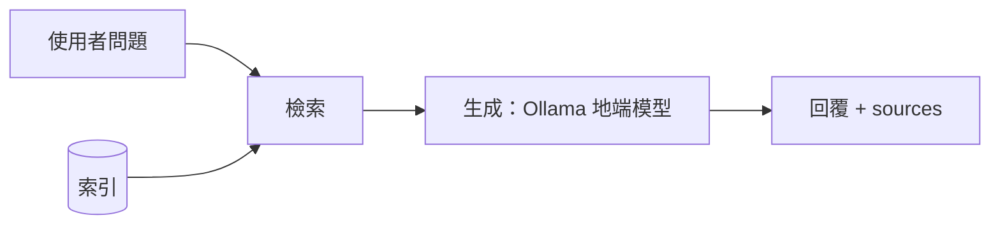

# 期中報告

> 繳交前請刪除所有 `>` 開頭的說明文字。

- 組別角色：（學生 AI 家教 / 教師 AI 助教 / 家長 AI 幫手 / 校長 AI 決策助手）
- 組員：（姓名、學號、GitHub 帳號）
- 繳交 commit：（`git rev-parse midterm` 的結果）

## 1. 系統架構

> 一張圖即可。標出切塊、索引、檢索、生成各在哪裡，以及哪條路徑走地端模型。
> 可以用 Mermaid 直接畫，GitHub 會自動顯示成圖，例如：



## 2. 設計決定與理由

| 項目 | 選擇 | 理由 |
| --- | --- | --- |
| 切塊方式 | 一個 `###` 段落一塊（共 25 塊），每塊記錄 `covered_ids` | 文件本身已用 `###` 切成語意完整、自帶 id 的段落，一塊對應一個 id，`sources` 不需另外計算歸屬。也試過整個 `##` 章節一塊與滑動視窗：章節切塊 Recall@3 從 1.00 掉到 0.78（S1-3 同時含新實驗室與晨讀，晨讀題 eval-16 掉到第 8 名）；滑動視窗會切斷段落，必須另外判斷一塊算哪一段，Recall@3 也只有 0.88。詳見 [方法比較實驗](retrieval-experiments.md#切塊方式)。 |
| 切塊大小（註明單位：字元或 token） | 依段落自然長度，不設上限：平均 83 字元，最短 32、最長 157 字元 | 最長的段落也遠低於 bge-m3 的 8192 token 輸入上限，再切小只會把一件事拆成兩半（例如 S1-2-1 的「育嬰留停」與「代理教師接任」）。滑動視窗實驗用 120 字元、重疊 40 字元（約一個半段落），沒有比段落切塊好。 |
| 嵌入模型 | `bge-m3`（1024 維，多語）；Docker 內透過主機 Ollama 的 `/api/embed` 地端執行 | 三個模型在同一條件下比較：bge-m3 的 Recall@3 為 1.00、MRR 0.90；bge-small-zh-v1.5（512 維）速度快約 10 倍，但「額外講義」對「補充教材」這題（eval-12）掉到第 4 名；多語 MiniLM（384 維，以英文為主訓練）各項最差（MRR 0.82）。選 bge-m3 的另一個原因是部署：Ollama 官方有 bge-m3，驗收機可地端執行、Docker 映像不用裝 torch；bge-small-zh 沒有官方 Ollama 版本。 |
| K 值 | 3（每次取 3 個切塊；段落切塊下即 3 個段落），`RETRIEVER_K` 可調 | K=1 時 A 只有 13/16、B 15/16，因為向量的第 1、2 名常常只差 0.01–0.02，排序不穩；K=3 兩版都 16/16，也剛好放得下跨兩段的題目（eval-08、09、10、14）。K=5 沒有多命中任何一題，多出的 2 段都無關，只會讓 3B 地端模型讀更長、更雜的 context。 |
| 檢索方法 | A：向量餘弦相似度；B：向量＋BM25（字元二元組）以 RRF 合併 | 向量擅長換句話說（「請長假、找人代課」對「育嬰留停、代理教師」，A 排第 1；BM25 排第 5）；BM25 擅長原文詞、班級代號與時間（805、16:10），兩者互補，B 的 MRR 從 0.90 提高到 0.97。中文 BM25 用字元二元組而不用 jieba：jieba 沒有比較好（Hit@3 一樣是 15/16），還多一個套件。不用重排序：bge-reranker-base 的 Hit@1 從 15 掉到 13、每題延遲約 5 倍，Docker 還得裝 torch。不用加權合併：需要正規化分數並調 α，MRR 0.94 也比 RRF 差。**限制**：在難題集（概括、口語問法）上 B 反而較差（Hit@3 10/12，A 為 12/12），因為問題和原文沒有共用詞時，BM25 那一路沒有訊號，還會把正確段落拖下去（見 §5、[第二輪實驗](retrieval-experiments.md#最重要的發現b-在難題集上反而比-a-差)）。 |
| 地端模型 | | |

## 3. 兩個版本

| | 版本 A（基本版） | 版本 B（改良版） |
| --- | --- | --- |
| 差異 | 段落切塊 → bge-m3 嵌入 → 問題向量與各段做餘弦相似度 → 取 Top-K | **只改檢索方法**：切塊、嵌入模型、K 都與 A 相同；另外用字元二元組建 BM25 索引，兩路各自排序後以 RRF（c=60）依名次合併，再取 Top-K |
| 如何切換執行 | `.env` 設 `RETRIEVER_VERSION=A`（預設），再執行 `docker compose up -d --force-recreate api`（只用 `restart` 不會重讀 `.env`） | `.env` 改成 `RETRIEVER_VERSION=B`，同樣重建 api 容器。每則回覆的 trace 會寫明實際版本，例如「版本B K=3 命中 S1-2-1, S2-3-1, …」。不重啟也能兩版都跑：`python scripts/eval_retrieval.py --k 3`（直接呼叫 `retrieve(query, k, version)`） |

另外做了 10 組只差一個變因的比較（嵌入模型、斷詞、合併方式、重排序、切塊方式），每種方法的優缺點與實際題目分析見 [docs/retrieval-experiments.md](retrieval-experiments.md)。

## 4. 評測集與命中紀錄

> 至少 10 題。「應命中」與「實際命中」都填段落 id。

評測集：`tests/retrieval_eval.jsonl`，16 題，涵蓋原文詞彙、換句話說、跨段落、詞彙不一致、數字代號五種題型。以下由 `python scripts/eval_retrieval.py --k 3` 產生。

命中定義：Top-K 的段落 id 含任一應命中 id；K = 3。

| # | 問題 | 應命中 | 版本 A 實際命中（Top-K） | A 命中？ | 版本 B 實際命中（Top-K） | B 命中？ |
| --- | --- | --- | --- | --- | --- | --- |
| 1 | 本學期三次段考的日期是什麼時候？ | S1-2-3 | S1-2-3, S1-1-2, S4-2-2 | 是 | S1-2-3, S1-1-2, S4-2-2 | 是 |
| 2 | 七年級自然科新實驗室什麼時候啟用？ | S1-3-1 | S1-3-1, S2-2-2, S1-1-2 | 是 | S1-3-1, S2-2-2, S1-1-2 | 是 |
| 3 | 本學期學習扶助開辦哪些科目？ | S4-1-2 | S4-1-2, S2-3-2, S4-1-3 | 是 | S4-1-2, S2-3-2, S4-1-1 | 是 |
| 4 | 學習扶助的成效要怎麼評估？ | S4-3-1 | S2-3-2, S4-1-3, S4-3-1 | 是 | S2-3-2, S4-3-1, S4-3-2 | 是 |
| 5 | 課後輔導班每班最多幾人、什麼時候上課？ | S4-2-1 | S4-2-1, S4-2-2, S2-3-2 | 是 | S4-2-1, S4-2-2, S4-1-2 | 是 |
| 6 | 家長希望換老師時學校要怎麼告知？ | S1-4-1 | S1-4-1, S4-2-2, S1-2-1 | 是 | S1-4-1, S1-2-1, S1-1-1 | 是 |
| 7 | 哪個班的英文課完全不用中文上課？ | S1-2-2, S3-2-1 | S4-1-2, S1-2-2, S3-2-1 | 是 | S3-2-1, S4-1-2, S1-2-2 | 是 |
| 8 | 805 班換數學老師之後，學生適應得如何？ | S1-2-1, S2-3-1 | S1-2-1, S2-3-1, S2-1-1 | 是 | S1-2-1, S2-1-1, S2-3-1 | 是 |
| 9 | 903 班全英語授課的目的，以及學生目前的反應？ | S1-2-2, S3-2-1 | S3-2-1, S1-2-2, S4-1-1 | 是 | S3-2-1, S1-2-2, S4-1-1 | 是 |
| 10 | 這學期有老師請長假、找人代課嗎？ | S1-2-1, S2-3-1 | S1-2-1, S4-2-1, S2-3-1 | 是 | S1-2-1, S1-1-2, S1-3-2 | 是 |
| 11 | 八年級數學這學期的內容，學生為什麼容易卡關？ | S2-2-1 | S2-2-1, S1-2-1, S2-2-2 | 是 | S2-2-1, S1-2-1, S2-2-2 | 是 |
| 12 | 九年級英文的額外講義為什麼讓學生覺得吃力？ | S3-2-2 | S3-2-2, S1-2-2, S2-2-3 | 是 | S3-2-2, S2-2-3, S1-2-2 | 是 |
| 13 | 每週一、三 16:10 開始的課是什麼？ | S4-2-1 | S4-2-1, S1-3-2, S4-1-2 | 是 | S4-2-1, S1-3-2, S1-1-2 | 是 |
| 14 | 學習扶助的名單是根據哪一次的成績篩選？ | S4-1-3, S2-3-2 | S2-3-2, S4-1-3, S4-2-2 | 是 | S2-3-2, S4-1-3, S4-2-2 | 是 |
| 15 | 七、八年級這學期有什麼英文相關的比賽？ | S3-3-1 | S3-3-1, S2-2-2, S1-2-2 | 是 | S3-3-1, S2-2-1, S4-1-2 | 是 |
| 16 | 學校有沒有推動學生多看課外書的活動？ | S1-3-2 | S4-1-1, S1-3-2, S3-2-2 | 是 | S1-3-2, S4-1-1, S4-1-3 | 是 |

| | 版本 A | 版本 B |
| --- | --- | --- |
| 命中率 | 16/16 = 100% | 16/16 = 100% |

其他 K 值的命中率：K=1 時 A 13/16（81%）、B 15/16（94%）；K=5 時兩版皆 16/16。

補充：另有 12 題難題集 `tests/retrieval_eval_hard.jsonl`（比較、否定、口語、抽象等問法），K=3 時 A 12/12（100%）、B 10/12（83%）。逐題結果見 [docs/retrieval-experiments-hard-raw.md](retrieval-experiments-hard-raw.md)。

> 量測環境：本機以 sentence-transformers 載入 `BAAI/bge-m3`（`EMBED_BACKEND=st`）。Docker 內使用 Ollama 的 `bge-m3`，是同一個模型，數值可能有小數點後的差異；裝好 Ollama 後需以 `EMBED_BACKEND=ollama` 重跑並更新本表。

## 5. 失敗案例

> 至少 2 個。只寫「找不到」不算，要寫出假設與驗證方法。

§4 的 16 題在 K=3 時兩版都命中，因此失敗案例取自：難題集中 K=3 真的沒命中的題目（hard-09）、K=1 沒命中、跨段落題只找回一段，以及比較實驗中其他方法的漏失。每個案例都實際做過驗證，結果寫在最後一欄。

| 問題 | 應命中 | 實際命中 | 你的假設 | 怎麼驗證 |
| --- | --- | --- | --- | --- |
| eval-10 這學期有老師請長假、找人代課嗎？（只用 BM25，K=3） | S1-2-1, S2-3-1 | S1-3-2, S4-3-1, S1-1-2 | ①詞彙不一致：原文寫「育嬰留職停薪」「代理教師」，問題寫「請長假」「代課」。②字元二元組產生跨詞假詞：「老**師請**長假」的「師請」剛好對上 S1-3-2「導**師請**協助督導」，而「師請」很少見、IDF 很高 | 列出問題與各段的共同二元組：S1-2-1 只有「學期」、S2-3-1 是 0 個、S1-3-2 有「學期」「師請」，證實兩個假設。把問題改寫成原文用字「申請留職停薪、由代理教師接任」後，S1-2-1 排第 1、S2-3-1 排第 2；同一題改用向量（版本 A）則 S1-2-1 第 1 → 詞彙不一致是主因 |
| eval-10 同上（版本 B，K=3） | S1-2-1, S2-3-1 | S1-2-1, S1-1-2, S1-3-2（漏掉 S2-3-1） | RRF 依名次平均兩路結果；S2-3-1 和問題沒有任何共同二元組，在 BM25 排第 20，即使向量排第 3，合併後也被 BM25 偏好的段落擠出 Top-3 | 印出兩路名次：S2-3-1 向量第 3／BM25 第 20；S1-3-2 向量第 12／BM25 第 1。只移除「師請」再合併，S1-3-2 離開 Top-3，但補進來的是 S4-1-2，S2-3-1 仍然沒回來 → 主因是 BM25 對 S2-3-1 完全沒有訊號，不是單一雜訊詞。加上 cross-encoder 重排序後 S2-3-1 回到第 2，也佐證是合併方式的問題 |
| hard-09 這學期學校有哪些硬體設施的改變？（版本 B，K=3） | S1-3-1 | S1-1-2, S4-1-2, S2-2-1（S1-3-1 排第 6） | 原文寫「實驗室整修」「實驗桌與通風設備」，和問題唯一的共同二元組是「學期」。BM25 的前 3 名都是靠「學期」「學校」這種到處都有的詞排上去的（S1-3-1 在 BM25 只排第 15），RRF 合併後把向量排第 1 的 S1-3-1 拖到第 6 | 列出 BM25 前 3 名與問題的共同二元組：S4-1-2 為「學期」「期學」、S1-4-1 為「學期」「學校」、S4-3-1 為「學期」，證實全是泛用詞。同一題只用向量（A）排第 1。用 HyDE 讓 LLM 先把問題寫成書面語，也排第 1。同義詞擴展無效，因為辭典沒有「設施」→ 擴展前後查詢完全相同 |
| eval-04 學習扶助的成效要怎麼評估？（版本 A，K=1） | S4-3-1 | S2-3-2（S4-3-1 排第 3） | S4-3-1 本文只寫「評估方式」「參加學生……成績變化」，沒有「學習扶助」也沒有「成效」，這兩個詞只出現在文件標題和 `## S4-3 成效評估`，段落切塊把上下文丟掉了；S2-3-2 則直接寫「學習扶助」兩次 | 改用「段落前加文件與章節標題」的切塊（`dense-ctx`）重跑：S4-3-1 升到第 2，與第 1 名的餘弦差距從 0.10 縮到 0.002，證實缺上下文是原因之一；但仍未到第 1，表示 S2-3-2 的關鍵字重疊確實更多 |
| eval-16 學校有沒有推動學生多看課外書的活動？（版本 A，K=1） | S1-3-2 | S4-1-1（S1-3-2 排第 2） | 向量抓到的是「為學生辦的措施」這種整體語意，S4-1-1「提供學習落後的學生額外的補強教學」也符合；真正的關鍵詞「課外書」和原文「課外讀物」只有部分相同，對向量影響很小。兩者餘弦只差 0.015，排序本來就不穩 | 換三種問法比較：「課外書」改成「課外讀物」→ S1-3-2 升第 1（但只領先 0.007）；只問「學生多看課外書」→ S1-3-2 反而掉到第 3；問「學校有沒有晨讀活動？」→ S1-3-2 以 0.71 大幅領先。證實向量對泛用語意敏感、對關鍵詞不敏感；版本 B 的 BM25 用「課外」二元組補上後排第 1 |

## 6. 公開測試題結果

> 執行 `python scripts/run_tests.py tests/<role>.jsonl`，貼上輸出，並說明主要的失敗原因。期中不以通過率計分。

> 【待辦】本機尚未安裝 Ollama 與 Docker，`/chat` 的生成步驟無法執行，所以這節還沒有真實輸出。裝好之後依序執行：
> `ollama pull qwen2.5:3b`、`ollama pull bge-m3`、`docker compose up --build`，再執行 `python scripts/run_tests.py tests/principal.jsonl`，把完整輸出貼在下方，並逐題說明失敗原因。

```
（貼上輸出）
```

## 7. AI 使用揭露

| 用在哪裡 | 使用的工具 | 用途 | 查核方式 |
| --- | --- | --- | --- |
| `tests/retrieval_eval.jsonl`（§4 評測集） | Claude Code | 依 S1–S4 文件草擬評測題與應命中段落 id（先 12 題，後補 eval-13～16 共 16 題） | `eval_retrieval.py` 啟動時檢查每個應命中 id 都存在於 `data/principal/docs/`（共 25 個段落），16 題全數通過；新增的 4 題逐題對照原文確認答案在該段 |
| `scripts/eval_retrieval.py` | Claude Code | 撰寫命中紀錄腳本（兩版 Top-K、命中率、Markdown 輸出） | 以 `--mock` 假檢索器執行 K=1、3、5；另寫檢查逐列比對「是否命中」與 Top-K id 是否一致，並重算命中率（K=1 兩版皆 8/12）；不加 `--mock` 時確認會回報無法匯入 `app.retrieval` |
| `ui/app.py` | Claude Code | 改標題、evidence 逐項顯示（查詢與結果）、缺欄位不報錯 | 以 Streamlit AppTest 對假的 `/chat` 送三種回應（完整、空陣列、缺欄位），確認五個展開欄皆出現且無例外 |
| `api/app/retrieval.py`（切塊、BM25、嵌入、版本 A／B 與實驗設定） | Claude Code | 撰寫四種切塊方式、BM25、RRF／加權合併、Ollama 與 sentence-transformers 兩種嵌入來源、Ollama 失敗時退回 BM25 | 檢查 25 個段落 id 與原文標題一致、每塊 `covered_ids` 都是真實 id；抽查視窗切塊 S1-w3 的文字確實橫跨 S1-2-1 與 S1-2-2；未開 Ollama 時以 FastAPI TestClient 確認 `/health` 仍回 200、trace 會寫明改用 BM25 |
| `scripts/compare_retrievers.py` 與 `docs/retrieval-experiments.md` | Claude Code | 撰寫比較腳本、執行 12 組設定、草擬各方法優缺點分析 | 分析中每個「為什麼」都另外跑過驗證：列出共同二元組、印出兩路名次、改寫問句重跑（指令與結果見 §5）；原本寫的 jieba 失敗原因經查證不成立，已改成實際查到的詞頻原因 |
| §2、§3、§5 文字 | Claude Code | 依實驗結果草擬設計理由與失敗案例 | 文中每個數字都對照 `docs/retrieval-experiments-raw.md` 與 `eval_retrieval.py` 的輸出逐一核對 |
| `tests/retrieval_eval_hard.jsonl`（12 題難題） | Claude Code | 依 S1–S4 草擬比較、否定、口語等較難的題目 | 先固定同義詞辭典才出題（避免辭典配合題目）；每題逐句對照原文，確認答案確實在所標的段落；`eval_retrieval.py` 檢查 id 都存在 |
| `api/app/retrieval.py` 第二輪（句子切塊、MMR、查詢擴展）與 `api/app/rag_variants.py`（HyDE、多重查詢、bge-m3 稀疏／多向量） | Claude Code | 撰寫進階 RAG 方法 | 以同一題（hard-11）逐一跑過所有方法，並印出中間結果（HyDE 文字、改寫問句、稀疏權重）人工檢查；bge-m3 稀疏／多向量依 FlagEmbedding 原始碼的算法實作，並確認權重檔來自同一模型 repo |
| `docs/retrieval-experiments.md` 第二輪分析 | Claude Code | 草擬各方法優缺點 | 每個原因都另外驗證：印出 BM25 共同二元組、兩兩段落相似度（MMR）、LLM 實際輸出（HyDE 幻覺、改寫飄移）、稀疏權重；並用程式逐題比對各方法與 A 的名次差異，修正了 3 處與數據不符的敘述 |
