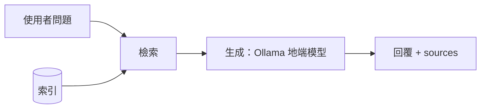

# 期中報告

> 繳交前請刪除所有 `>` 開頭的說明文字。

- 組別角色：（學生 AI 家教 / 教師 AI 助教 / 家長 AI 幫手 / 校長 AI 決策助手）
- 組員：（姓名、學號、GitHub 帳號）
- 繳交 commit：（`git rev-parse midterm` 的結果）

## 1. 系統架構

> 一張圖即可。標出切塊、索引、檢索、生成各在哪裡，以及哪條路徑走地端模型。
> 可以用 Mermaid 直接畫，GitHub 會自動顯示成圖，例如：



## 2. 設計決定與理由

| 項目 | 選擇 | 理由 |
| --- | --- | --- |
| 切塊方式 | | |
| 切塊大小（註明單位：字元或 token） | | |
| 嵌入模型 | | |
| K 值 | | |
| 檢索方法 | | |
| 地端模型 | | |

## 3. 兩個版本

| | 版本 A（基本版） | 版本 B（改良版） |
| --- | --- | --- |
| 差異 | | |
| 如何切換執行 | | |

## 4. 評測集與命中紀錄

> 至少 10 題。「應命中」與「實際命中」都填段落 id。

| # | 問題 | 應命中 | 版本 A 實際命中（Top-K） | A 命中？ | 版本 B 實際命中（Top-K） | B 命中？ |
| --- | --- | --- | --- | --- | --- | --- |
| 1 | | | | | | |
| 2 | | | | | | |
| 3 | | | | | | |
| 4 | | | | | | |
| 5 | | | | | | |
| 6 | | | | | | |
| 7 | | | | | | |
| 8 | | | | | | |
| 9 | | | | | | |
| 10 | | | | | | |

| | 版本 A | 版本 B |
| --- | --- | --- |
| 命中率 | | |

## 5. 失敗案例

> 至少 2 個。只寫「找不到」不算，要寫出假設與驗證方法。

| 問題 | 應命中 | 實際命中 | 你的假設 | 怎麼驗證 |
| --- | --- | --- | --- | --- |
| | | | | |
| | | | | |

## 6. 公開測試題結果

> 執行 `python scripts/run_tests.py tests/<role>.jsonl`，貼上輸出，並說明主要的失敗原因。期中不以通過率計分。

```
（貼上輸出）
```

## 7. AI 使用揭露

| 用在哪裡 | 使用的工具 | 用途 | 查核方式 |
| --- | --- | --- | --- |
| | | | |
